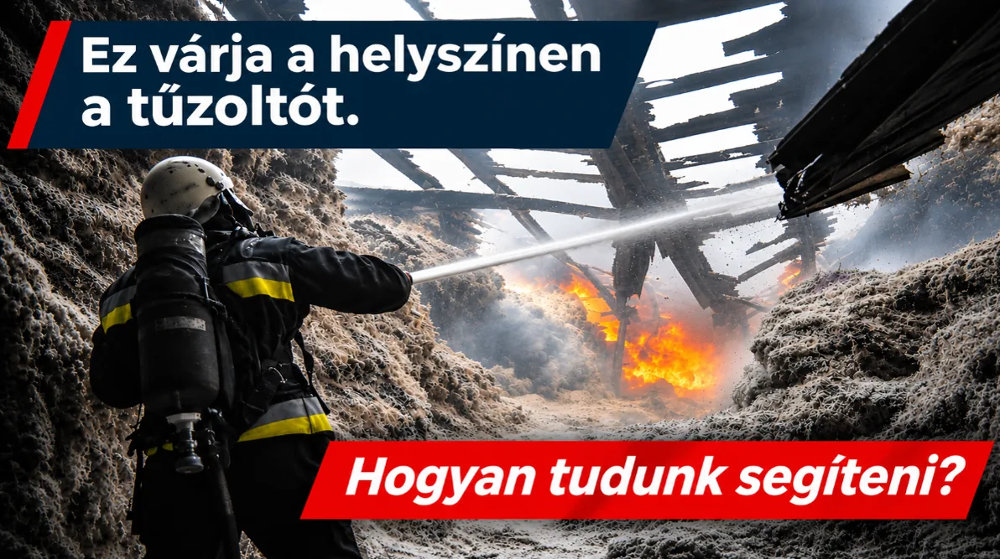
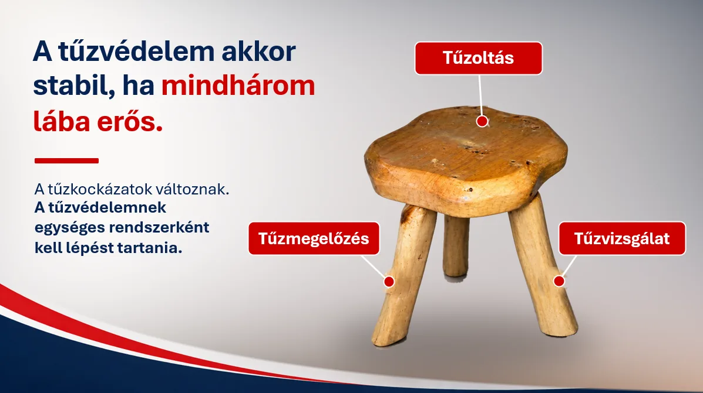
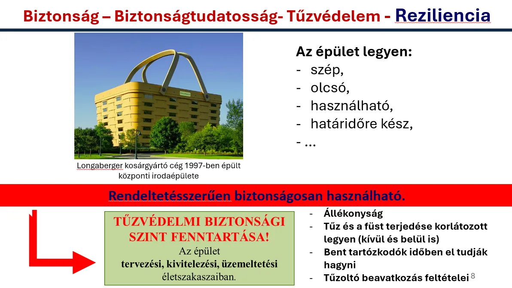
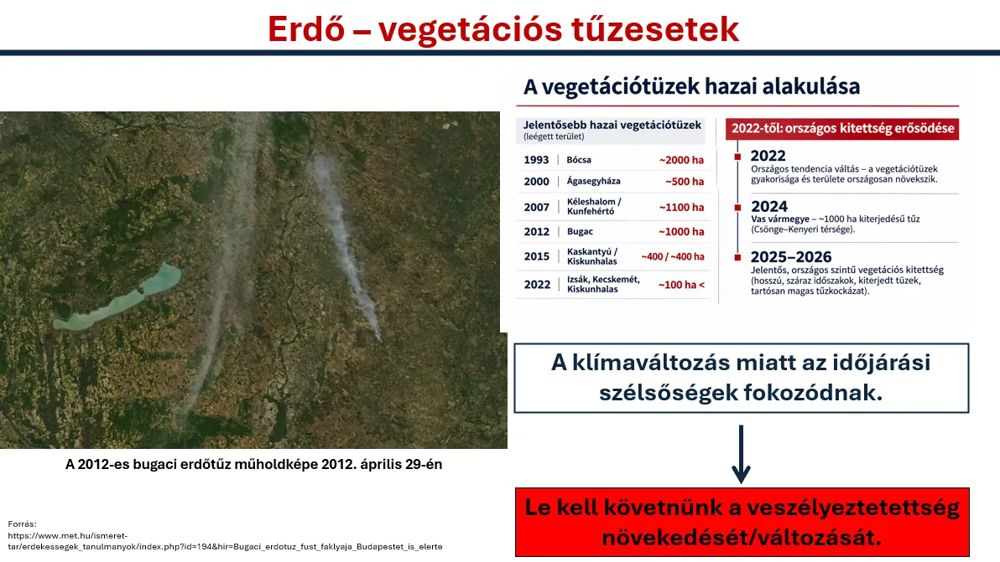

**2026. november 12-én az Országgyűlés Honvédelmi és Rendészeti Bizottságának ülésén Dr. Gyapjas János PhD, a Magyar Tűzvédelmi Egyeztető Fórum (MTEF) koordinátora rövid, vetített előadással egészítette ki a Fórum által benyújtott két szakmai dokumentumot. A tájékoztató a magyar tűzvédelem korszerűsítésének rendszerszintű összefüggéseire, a változó kockázatokra és a lehetséges fejlesztési irányokra irányította a figyelmet.**

A rendelkezésre álló időkeret elsősorban a legfontosabb problémák és összefüggések felvillantását tette lehetővé. Ezért az alábbi összeállítás a bizottsági ülésen bemutatott prezentáció fő gondolatait és az azokhoz kapcsolódó szakmai javaslatokat részletesebben ismerteti.

A központi üzenet: **a változó tűzkockázatokra nem elegendő különálló intézkedésekkel reagálni; a tűzvédelmi rendszer egészének összehangolt, adatvezérelt és kockázatarányos fejlesztésére van szükség.**

## A tűzoltói beavatkozás nélkülözhetetlen – a tűzvédelem közös felelősség

A tűzvédelmi biztonság sok szereplő tevékenységének együttes eredménye. A jogalkotók, a hatóságok, a tervezők, a kivitelezők, az üzemeltetők, a tűzoltók, a kutatók, az oktatási intézmények, a szakmai szervezetek és a lakosság egyaránt alakítják a kockázatokat és a védekezés feltételeit.

A rendszer eredményessége ezért nem kizárólag a tűzoltóságok felkészültségén vagy beavatkozási képességén múlik. Meghatározó jelentőségűek azok a döntések is, amelyek jóval a tűzeset bekövetkezése előtt születnek meg.

Amikor a tűzeset bekövetkezik, a közvetlen életmentésben és a tűz megfékezésében a tűzoltói beavatkozásnak meghatározó, elsődleges szerepe van. A tűzvédelmi rendszer eredményessége végső soron a helyszínen is megmérettetik, ahol a beavatkozó tűzoltóknak gyakran nehéz és veszélyes körülmények között kell helytállniuk. Szakmai felkészültségük, elkötelezettségük és áldozatvállalásuk nélkülözhetetlen, munkájuk kiemelt szakmai és társadalmi megbecsülést érdemel. A rendszerszemléletű megközelítés nem csökkenti szerepük jelentőségét, hanem éppen arra hívja fel a figyelmet, hogy a teljes tűzvédelmi rendszernek támogatnia kell munkájuk eredményességét és biztonságát.

Ezt szemléltette a prezentáció egyik központi kérdése: **mi várja a helyszínen a beavatkozó tűzoltót, és mit tehetünk azért, hogy kedvezőbb feltételekkel végezhesse a munkáját?**

A válasz jelentős része a megelőzésben, a megfelelő műszaki kialakításban, az épületek biztonságos üzemeltetésében, a lakosság felkészítésében és a veszélyek korai felismerésében keresendő.

A tűzvédelem három hagyományos alappillére – a **tűzmegelőzés, a tűzoltás és a tűzvizsgálat** – egymástól elválaszthatatlan. A megelőzés csökkenti a tűzesetek bekövetkezésének valószínűségét és következményeit, a tűzoltás az életmentést és a károk mérséklését szolgálja, a tűzvizsgálat pedig lehetővé teszi, hogy a bekövetkezett események tapasztalatai visszaépüljenek a megelőzésbe, a szabályozásba, a képzésbe és a beavatkozási gyakorlatba.

**A tűzvédelem akkor stabil, ha mindhárom pillére erős, és azok egymást támogatva működnek.**

Ehhez közös problémafeltárásra, az eredmények együttes értelmezésére, a tapasztalatok megosztására és a különböző szereplők összehangolt cselekvésére van szükség.

## A biztonságot nem elég megtervezni – fenn is kell tartani

Az épületekkel szemben számos elvárást fogalmazunk meg: legyenek esztétikusak, gazdaságosan megvalósíthatók, jól használhatók és határidőre elkészíthetők. Mindezek mellett azonban alapvető követelmény, hogy rendeltetésszerű használatuk során megfelelő biztonságot nyújtsanak.

A tűzvédelmi biztonság nem ér véget az épület átadásával. A szerkezetek állékonyságának, a tűz és a füst terjedése korlátozásának, a menekülés és a tűzoltói beavatkozás feltételeinek a teljes használati élettartam során megfelelő szinten kell maradniuk.

Ezért a tűzvédelmi biztonsági szint fenntartása éppúgy része a tűzmegelőzésnek, mint a helyes tervezés és kivitelezés. Az épületek átalakítása, rendeltetésének vagy használati körülményeinek változása, illetve a tűzvédelmi rendszerek nem megfelelő karbantartása a korábban kialakított biztonsági szintet is kedvezőtlenül befolyásolhatja.

**A tényleges biztonság nem kizárólag az építéskori megfelelőség kérdése, hanem az épület teljes életciklusán átívelő közös felelősség.**

## A tűz fejlődése és a tűzoltósági elérhetőség között jelentős időbeli különbség lehet

A prezentáció a tűzfejlődés gyorsaságát és a tűzoltósági elérhetőséget is összevetette.

Kísérleti eredmények alapján bizonyos, korszerű berendezési tárgyakkal kialakított helyiségekben, kedvezőtlen feltételek mellett már **3–5 perc alatt kialakulhat a teljes helyiségre kiterjedő tűz (flashover)**.

Ezzel szemben a bemutatott országos térinformatikai elérhetőségi modell szerint Magyarország lakosságának 64,07%-a tartozik a 15 perces, 93,11%-a pedig a 25 perces tűzoltósági elérhetőségi zónába. Ezek modellezett területi elérhetőségi adatok, nem a tényleges riasztástól a kiérkezésig eltelt idők országos statisztikái.

A két jelenség összevetése rámutat arra, hogy a tűzeset kritikus szakasza a tűzoltók megérkezése előtt is kialakulhat. Ezért különösen fontos a korai tűzészlelés és tűzjelzés, a megfelelő menekülési lehetőségek, a lakossági biztonságtudatosság és a tűz kialakulását, illetve terjedését korlátozó műszaki megoldások alkalmazása.

**A megelőzés és a korai védelem nem helyettesíti a tűzoltói beavatkozást, hanem annak eredményességét is alapvetően befolyásolja. A megfelelő megelőzés, a biztonságos épületkialakítás és a korai tűzjelzés nemcsak az épületek használóit védi, hanem a beavatkozó tűzoltók számára is kedvezőbb, biztonságosabb feltételeket teremthet.**

## Az önkéntes tűzoltó egyesületek komplex fejlesztésének jelentősége

A mentő tűzvédelmi biztonság erősítésében fontos szerep juthat az önkéntes tűzoltó egyesületeknek (ÖTE-k) is. Különösen azokon a településeken és térségekben jelenthetnek értékes helyi kapacitást, ahol a hivatásos tűzoltóságok elérhetősége kedvezőtlenebb, illetve ahol a vegetációtüzek vagy más helyi sajátosságok fokozott veszélyeztetettséget eredményeznek.

Az önkéntes tűzoltó egyesületek fejlesztését ezért nem kizárólag eszközbeszerzési vagy finanszírozási kérdésként, hanem **komplex, hosszú távú képességfejlesztési feladatként** indokolt kezelni.

Ennek része a megfelelő személyi állomány biztosítása és utánpótlása, a képzés és felkészítés, a technikai és infrastrukturális feltételek fejlesztése, a működés fenntarthatósága, valamint a hivatásos tűzoltóságokkal való együttműködés erősítése.

Az ÖTE-k emellett a közösségi tűzmegelőzésben, a lakosság biztonságtudatosságának fejlesztésében és a helyi veszélyhelyzeti felkészülésben is fontos szerepet tölthetnek be.

A fejlesztéseket az országos tűzvédelmi problématérképre és a helyi kockázatokra alapozva, differenciáltan célszerű meghatározni. Nem önmagában az egyesületek számának vagy eszközállományának növelése a cél, hanem a **helyi veszélyeztetettséghez és a tényleges feladatokhoz igazodó, fenntartható és mérhető tűzvédelmi képességek kialakítása.**

## A változó környezeti feltételek új kihívásokat jelentenek

A klímaváltozás, a szélsőséges időjárási helyzetek, a tartós szárazság és a vegetációs viszonyok változása új feladatok elé állítják a magyar tűzvédelmet.

A hazai erdő- és vegetációtüzek tapasztalatai, különösen a 2022-től jelentkező fokozott kitettség, azt mutatják, hogy a tűzveszély nem kezelhető kizárólag a korábbi események gyakorisága alapján. Figyelembe kell venni a tűzterjedés lehetőségeit, a lakott területek és az erdők találkozását, a települések sajátosságait, a megközelíthetőséget és a rendelkezésre álló beavatkozási képességeket is.

Különös figyelmet érdemelnek a vegetációval érintkező lakott területek, az úgynevezett WUI-zónák (Wildland–Urban Interface), ahol a természeti környezetben kialakuló tűz közvetlenül veszélyeztetheti az épületeket, az infrastruktúrát és a lakosságot.

A veszélyeztetettség térben és időben egyaránt változik. A tűzvédelmi felkészülésnek ezt a változást folyamatosan követnie kell.

Az erdő- és vegetációtüzek kezelése ezért nem kizárólag tűzoltási vagy erdőgazdálkodási kérdés, hanem a települések, a természeti környezet és az infrastruktúrák ellenálló képességének, vagyis rezilienciájának is fontos része.

A hatékony megelőzés és felkészülés az érintett ágazatok együttműködését, a helyi kockázatok ismeretét, a közösségek bevonását és a tűzoltói képességek célzott fejlesztését egyaránt igényli.

## Az országos tűzvédelmi problématérképtől a nemzeti stratégiáig

Az MTEF egyik legfontosabb javaslata egy **országos tűzvédelmi problématérkép** elkészítése, amely megalapozhatja a **nemzeti tűzvédelmi stratégia** kidolgozását.

A problématérkép nem egyszerűen a tűzesetek földrajzi megjelenítését jelentené. A tűzeseti és tűzvizsgálati tapasztalatok, a tűzoltósági elérhetőség és beavatkozási képességek, az épületállomány, a települési és területi sajátosságok, valamint az ipari, környezeti és vegetációs kockázatok együttes értékelésével átfogó képet adhatna a magyar tűzvédelem helyzetéről.

A problématérképnek nemcsak a veszélyeket, hanem a meglévő védelmi képességeket, azok területi különbségeit és a rendszer működését befolyásoló összefüggéseket is vizsgálnia kellene.

Segítségével azonosíthatók lennének a jelentősebb veszélyeztetettségek, a rendszer hiányosságai, a kedvezőtlen kockázati összefüggések és azok a területek, ahol a fejlesztések a legnagyobb biztonsági eredményt hozhatják.

A problématérkép így nem pusztán helyzetértékelést, hanem a fejlesztési döntéseket támogató, rendszeresen aktualizálható szakmai alapot jelenthetne.

Erre épülhetne egy szakmai konszenzuson alapuló nemzeti tűzvédelmi stratégia, amely világos célokat, fejlesztési prioritásokat, felelősségi köröket, ütemezést és mérhető eredményeket határoz meg.

A stratégia fontos eleme lehetne a tűzmegelőzési rendszer korszerűsítése, a tűzoltói reagálóképesség fejlesztése, a tűzvizsgálati tapasztalatok hatékonyabb hasznosítása, a lakossági biztonságtudatosság erősítése, valamint az önkéntes tűzoltó egyesületek komplex fejlesztése is.

**A cél nem önmagában több intézkedés vagy több fejlesztés, hanem a rendelkezésre álló erőforrások olyan összehangolt felhasználása, amely a legjelentősebb kockázatokat csökkenti, és mérhető élet- és vagyonvédelmi eredményeket hoz.**

## Fokozatos, kockázatalapú fejlesztés – rövid, közép- és hosszú távon

A bemutatott szakmai megközelítés három egymásra épülő cselekvési időtávot javasol.

**Rövid távon (0–12 hónap)** az országos tűzvédelmi problématérkép elkészítése teremthetné meg a fejlesztések közös ténybeli és szakmai alapját. Ehhez a rendelkezésre álló adatok, kutatási eredmények és gyakorlati tapasztalatok összehangolt értékelésére van szükség.

**Középtávon (1–3 év)** a nemzeti tűzvédelmi stratégia kidolgozása következhetne, amely széles körű szakmai egyeztetés alapján meghatározná az országos célokat, prioritásokat, felelősségi köröket és a megvalósítás ütemezését.

**Hosszú távon (3–10 év)** a célzott fejlesztések végrehajtása és eredményességük rendszeres visszamérése biztosíthatná a rendszer folyamatos korszerűsítését. Ennek része lehetne a megelőzés, a reagálóképesség, az önkéntes tűzoltói kapacitások, a képzés, a kutatás és a tűzeseti tapasztalatok hasznosításának fejlesztése.

A három időtáv egymásra épülő, de nem egymást kizáró feladatokat jelent. A már ismert és sürgető kockázatok kezelését nem szükséges a stratégia elkészültéig elhalasztani, ugyanakkor a hosszabb távú fejlesztéseket célszerű egységes szakmai keretbe rendezni.

## Közös felelősség, közös szakmai munka

A magyar tűzvédelem korszerűsítése nem valósítható meg egyetlen szervezet vagy ágazat önálló tevékenységével.

A bizottsági tájékoztató ezért az országos szakmai párbeszéd és a más ágazatokkal történő kapcsolatfelvétel támogatását is kezdeményezte. Különösen fontos az erdőgazdálkodás, az agrárium, az építésügy, a településfejlesztés, a környezetvédelem, valamint az oktatás és a kutatás szereplőinek bevonása.

A Magyar Tűzvédelmi Egyeztető Fórum szakértői tudással, kutatási eredményekkel, adatokkal és szakmai együttműködéssel kíván hozzájárulni ehhez a munkához.

A közös cél egy olyan magyar tűzvédelmi rendszer, amely képes felismerni és értékelni a változó kockázatokat, összehangolni a megelőzés és a beavatkozás lehetőségeit, tanulni a bekövetkezett tűzesetekből, és a rendelkezésre álló erőforrásokat a legnagyobb biztonsági eredmény érdekében felhasználni.

A korszerűsítés egyik fontos mércéje az is, hogy a megvalósított intézkedések mennyiben segítik a beavatkozó tűzoltók munkáját, növelik biztonságukat, és javítják az életmentés, valamint a kárelhárítás eredményességét.

A bizottsági prezentáció záró üzenete ezt a szemléletet foglalta össze:

**„Ne a következő nagy tűz mutassa meg, mire nem készültünk fel. Tegyünk közösen a biztonságunkért.”**
