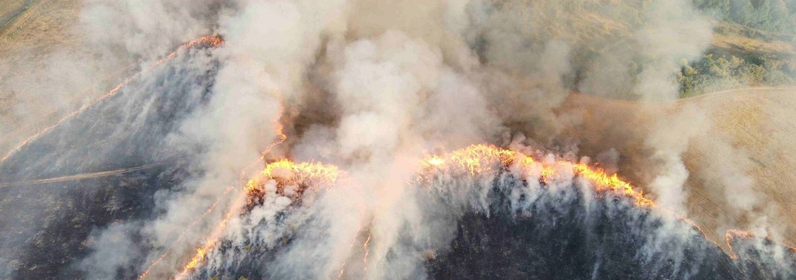
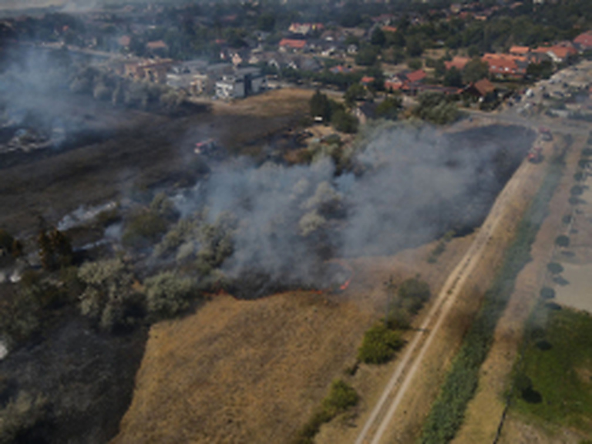
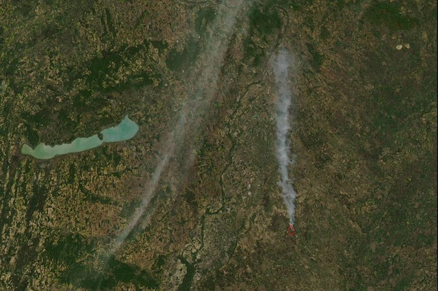
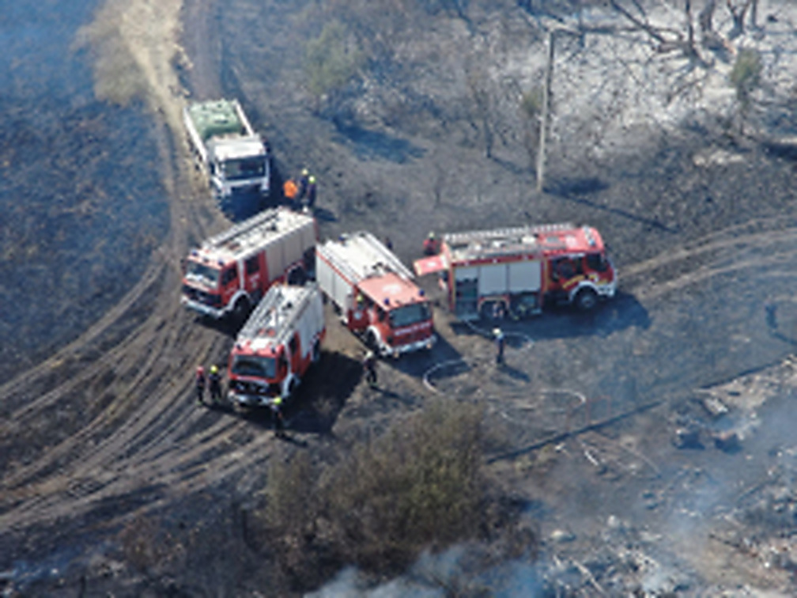

**A Magyar Tűzvédelmi Egyeztető Fórum arra hívja fel a figyelmet, hogy az erdő- és vegetációtüzek kockázatának kezelése nem csupán tűzvédelmi feladat, hanem a klímaváltozáshoz való alkalmazkodás és a települések, térségek ellenálló képességének egyik alapvető kérdése.**

A tartós szárazság, a hőhullámok és a növényzet kiszáradása önmagukban nem gyújtanak tüzet, de jelentősen növelik annak esélyét, hogy egy emberi vagy műszaki gyújtóforrásból gyorsan terjedő, nagy erőket igénylő, lakóterületeket és infrastruktúrát veszélyeztető káresemény alakuljon ki. A kockázat növekedése ezért nem feltétlenül azt jelenti, hogy minden évben több tűz keletkezik, hanem azt, hogy a tűz gyors terjedését és súlyos következményeit elősegítő feltételek kedvezőtlen irányban változnak.

Az elmúlt hetek, valamint a Tapolca, Mórahalom, Várpalota és Öskü térségében történt újabb tüzek ennek a hosszabb ideje változó kockázatnak a kézzelfogható magyarországi megjelenései. A felkészülésnek ezért nemcsak az aktuális hőségre kell reagálnia: a kockázat változását folyamatosan követő, adatvezérelt, helyben differenciált és széles együttműködésre épülő rendszerre van szükség.

A tűzvédelem ebben az összefüggésben a klímareziliencia része. Az államnak, az önkormányzatoknak, a gazdálkodóknak, a szakmai és civil szervezeteknek, a tűzoltóságoknak és a lakosságnak közösen kell csökkentenie a veszélyeztetettséget, biztosítania a beavatkozás feltételeit, védenie a települések és az infrastruktúrák működőképességét, valamint feldolgoznia a tűzesetek tapasztalatait.

*Sajókápolna külterülete, 2026. augusztus 10. A mintegy 450 hektárt érintő vegetációtűz aktív tűzfrontja drónfelvételen. Fotó: Dojcsák Dávid tűzoltó százados / Borsod-Abaúj-Zemplén VMKI. Forrás: [Borsod-Abaúj-Zemplén VMKI](https://baz.katasztrofavedelem.hu/24002/hirek/298531/tobb-szaz-hektaron-pusztitott-a-tuz)*

## Az elmúlt két hét és az újabb tüzek megmutatták, mekkora a veszély

Július vége és augusztus 14. között országszerte egymást követték az erdő- és vegetációtüzek. Július 30-án egyetlen nap alatt 35 erdő- és vegetációtüzet jeleztek országosan. Augusztus 10-én csak Borsod-Abaúj-Zemplén vármegyében húsz vegetációtűzhöz vonultak a tűzoltók. Augusztus 11-én országosan összesen 161 tűzesetet kezeltek; ez utóbbi adat valamennyi tűzesetet, nem kizárólag a vegetációtüzeket tartalmazza. Augusztus 12-én az országos tűzeseti terhelés tovább nőtt: a katasztrófavédelem egységei 185 tűzesetet kezeltek. Csak Borsod-Abaúj-Zemplén vármegyében 27 vegetációs tűzhöz vonultak a tűzoltók. [1][9]

A legnagyobb nyilvánosan dokumentált tűz Sajókápolna külterületén mintegy 450 hektárt érintett. Székesfehérváron közel 150 hektáron égett a növényzet, és a gyorsan terjedő lángok miatt 40 ingatlan 61 lakóját kellett ideiglenesen kitelepíteni. Kiskunfélegyháza térségében mintegy 110 hektáron pusztított a tűz, tanyákat, erdőt és vasúti környezetet is érintve; az eseményben egy ember életét vesztette. A Tiszalök–Újtelepi erdő körülbelül 70 hektáros tüze több napon át tartó beavatkozást igényelt.[1][2]

Augusztus 11-én Tapolca térségében három különálló vegetációtűz összesen mintegy 37 hektárt érintett. A tüzeknél koronaégés, épületre terjedés és ismételt visszagyulladás is előfordult; a Rózsadomb utca térségében végrehajtott beavatkozásban 158 tűzoltó és 45 technikai eszköz vett részt. Ugyanezen a napon Mórahalom tanyavilágában két közeli tűz összesen 56 hektárt érintett. Három tanya melléképületei is meggyulladtak, a lakóépületeket azonban sikerült megvédeni.[9]

Augusztus 12-én Veszprém vármegyében három, egymáshoz közeli, de egymástól elkülönülő nagy tűzeset történt. Várpalota külterületén közel 15 hektár gaz, avar és tarló égett, a tűz két présházra is átterjedt, az egyik épület felső szintjéről pedig egy embert létrával mentettek ki. Öskün, a Mecset és az Ibolya utca térségében körülbelül 20 hektár száraz növényzet égett, egy melléképület teljesen leégett, a lángok pedig több lakóház telkét is elérték. Ettől különálló eseményként Sóly és Öskü között, a 8-as főút közelében a legfrissebb hivatalos adatok szerint mintegy 300 hektáron égett az aljnövényzet, a tarló, a fenyves és a bokros-füves terület. Az oltást két honvédségi helikopter, katonai vízszállítók, önkéntes tűzoltók, civilek, polgárőrök és munkagépek is segítették. Augusztus 13-án délután az izzó gócpontok és égő törzsek felderítése és oltása még folyt.[10]

A hivatkozott események területe meghaladja az 1500 hektárt. Ez nem a teljes országos leégett terület: nincs benne a több száz kisebb vagy csak összesítve közölt eset. [1][2][9][10]

A vizsgált időszakban négy, vegetációt is érintő tűzesethez kapcsolódott haláleset. Ez egyértelművé teszi, hogy ezek az események nemcsak természeti vagy mezőgazdasági károkat okozhatnak, hanem közvetlen életveszélyt is jelenthetnek.[1]

A lángok több helyen lakóházakat, tanyákat, állatokat, közlekedési infrastruktúrát, benzinkutat, műemlékeket és kegyhelyeket is veszélyeztettek. Székesfehérváron kitelepítésre volt szükség, Ercsiben lakóépületek és nagy számú állat került veszélybe, Tapolcán lakóházak mellett melléképület is kigyulladt, Mórahalomnál tanyaépületek égtek, Várpalotán két présházat értek el a lángok, Sajószentpéteren az égő növényzetről lakóházra terjedt át a tűz. Ezek sajnos ismét közvetlenül megmutatták a vegetációval érintkező lakott területek veszélyeztetettségét. Öskün pedig a tűz lakóházakat és közlekedési útvonalakat veszélyeztetett. A vegetációtűz ilyen környezetben már nem kizárólag erdészeti vagy mezőgazdasági esemény, hanem településvédelmi, lakosságvédelmi, közlekedésbiztonsági és életmentési feladat.[1][2][9][10]

*Székesfehérvár, 2026. augusztus 5. A tűzzel érintett terület és a közeli lakóövezet. Fotók: Ribi Márk tűzoltó őrmester és Olasz András tűzoltó százados / Fejér VMKI. Forrás: [Fejér VMKI](https://fejer.katasztrofavedelem.hu/24277/hirek/298427/tuz-keletkezett-augusztus-5-en-delelott-szekesfehervaron-a-kapos-utcaban)*

> *A mostani tüzek nem egymástól független hírek. Egy hosszabb ideje növekvő és átalakuló kockázat nyilvánvaló magyarországi megjelenései.*

## Nem átmeneti szélsőségről, hanem tartósan változó kockázatról van szó

A tűzesetek közvetlen keletkezési okát minden esetben külön kell vizsgálni. A szárazság és a szél önmagában nem gyújtóforrás, de alapvetően meghatározza, hogy egy tűz milyen gyorsan terjed, mekkora intenzitást ér el, és milyen következményeket okoz.

A meteorológiai és vegetációs feltételek kifejezetten kedvezőtlenek. A HungaroMet 2026. augusztus 10-i értékelése szerint az Alföldön és a Mezőföldön nagy területeken az előző harminc napban 5 milliméter csapadék sem hullott, az ország döntő részén a talaj nedvességtartalma a növények számára hasznosítható vízkészlet 25 százalékát sem érte el, és az ország túlnyomó részén nagyfokú vagy súlyos mezőgazdasági aszály állt fenn.[3]

A Nébih naponta frissülő térképe szerint a vizsgált időszakban Magyarország teljes területén tűzgyújtási tilalom volt érvényben. A tilalom az erdőkre, a fásításokra, az ezek 200 méteres körzetében fekvő külterületi ingatlanokra, a kijelölt tűzrakóhelyekre, valamint a vasút és közút menti fásításokra is kiterjed; a parlag- és gazégetés sem megengedett.[4][8]

Az éves tűzesetszámok természetesen ingadoznak. A növekvő kockázat alatt nem megszakítás nélküli esetszám-emelkedést, hanem a tűz keletkezését, gyors terjedését és súlyos következményeit elősegítő feltételek kedvezőtlen irányú változását értjük. Ugyanaz a gyújtóforrás kiszáradt növényzetben, erős szélben, nehezen megközelíthető területen vagy lakott környezet közelében lényegesen súlyosabb eseményt idézhet elő.[6][7]

### A kockázatot egyszerre befolyásolja:

- a hőmérséklet, a csapadékhiány, a szél és a növényzet nedvességtartalma;
- a száraz fű, avar, nád, cserje és erdei aljnövényzet mennyisége és folytonossága;
- az erdők, mezőgazdasági területek és lakott térségek közvetlen érintkezése;
- a tanyák, gazdasági épületek és más külterületi létesítmények elhelyezkedése;
- a tűzoltósági elérhetőség és a helyi első beavatkozási képesség;
- a megközelítési utak, tűzpászták és oltóvízforrások állapota;
- az egyidejű tűzesetekből eredő erő-, eszköz- és vízellátási igény.

A XXI. századi tűzvédelmi kockázatokat a klímaváltozás mellett a társadalmi-gazdasági változások, az urbanizáció, a településszerkezet és a demográfiai folyamatok is alakítják. A veszélyeztetettség ezért térben jelentősen eltérhet, és nem kezelhető minden településen, minden térségben azonos módon.[5][7]

A nagy kiterjedésű erdőtüzek Magyarországon nem új jelenségek. Bács-Kiskun vármegyében az elmúlt évtizedekben többek között Bócsa, Ágasegyháza, Kunfehértó–Kéleshalom, Bugac, Kaskantyú és Kiskunhalas térségében is több száz vagy több ezer hektárt érintő, hosszan tartó tüzek történtek. A korábbi tapasztalatok már évekkel ezelőtt rámutattak arra, hogy a megfelelő felkészülés és megelőzés érdekében folyamatosan követni kell a veszélyeztetettség változását, a visszatérő tapasztalatokat pedig fel kell használni és adaptálni kell.[6]

*A HungaroMet tanulmányának 4. ábrája: Aqua/MODIS műholdkép, 2012. április 29. 13:40. A bugaci erdőtűz füstfáklyája elérte Budapest pesti oldalát. Forrás: NASA; közzétette: [HungaroMet](https://www.met.hu/ismeret-tar/erdekessegek_tanulmanyok/index.php?id=194&hir=Bugaci_erdotuz_fust_faklyaja_Budapestet_is_elerte)*

## A tegnap kockázataira épülő felkészülés már nem elegendő

Az erdő- és vegetációtűz-kockázat nem állandó. Napokon belül megváltozhat az időjárás és a növényzet állapota, évek alatt pedig átalakulhat a területhasználat, a beépítettség, a vegetáció szerkezete, az oltóvízellátás, a megközelíthetőség és a helyi tűzoltói kapacitás. Ezért a kockázat változását több időléptékben kell követni.[5][7]

**Napi és heti szinten** értékelni kell a meteorológiai tűzveszélyt, a növényzet kiszáradását, a várható szélviszonyokat, az aktuális tűzeseti terhelést és azokat a területeket, ahol lakóépületek vagy más értékek kerülhetnek veszélybe.

**A tűzveszélyes időszak előtt** fel kell mérni a településszéli és külterületi veszélyeztetett zónákat, a tanyákat, az állattartó telepeket, a tűzpásztákat, a megközelítési útvonalakat, az oltóvízforrásokat és a bevonható helyi erőket.

**Hosszú távon** elemezni kell a tűzesetek számának, területi eloszlásának és következményeinek változását, a vegetációval érintkező lakóterületek helyzetét, a tűzoltósági elérési időket és a szükséges erőforrásokat.

A tűzvédelmi döntéseknek valós kockázatokon, mérhető adatokon és helyi sajátosságokon kell alapulniuk. Országosan egységes szakmai alapelvekre, de helyben differenciált megoldásokra van szükség. A jelentős tüzek tapasztalatait rendszerszerűen vissza kell vezetni a megelőzésbe, a szabályozásba, az üzemeltetésbe, a képzésbe és a beavatkozási gyakorlatba.[5][7]

## A vegetációtűz nem kizárólag tűzoltósági probléma

A tűzoltóság akkor kap riasztást, amikor a tűz már kialakult. A beavatkozás eredményességét azonban jelentősen meghatározza, hogy mi történt a tűz keletkezése előtt.

Kezelték-e a száraz növényzetet? Járhatók-e az utak? Megközelíthetők-e a tanyák és a külterületi ingatlanok? Rendelkezésre áll-e oltóvíz? Ismertek-e a veszélyeztetett épületek és személyek? Felkészültek-e a helyi szervezetek? Tudja-e a lakosság, mit kell tennie?

A tapolcai eseménysorban a hivatásos, önkormányzati és önkéntes tűzoltók mellett civilek és munkagépek is részt vettek a védekezésben. A várpalotai és ösküi tüzekhez több településről, illetve több vármegyéből kellett egységeket összevonni. Ez világosan mutatja, hogy a jelentős vegetációtüzek kezelése már a káresemény idején is széles körű együttműködést követel meg - ezt az együttműködést azonban a megelőzés és a felkészülés időszakában is előre meg kell szervezni.[9][10]

> *A káresemény felszámolásakor az együttműködés már kényszerűen létrejön. Ugyanezt az együttműködést a tűz keletkezése előtt, a megelőzés és a felkészülés időszakában is meg kell szervezni.*

*Tűzoltóegységek a székesfehérvári tűz területén. Fotók: Ribi Márk tűzoltó őrmester és Olasz András tűzoltó százados / Fejér VMKI. Forrás: [Fejér VMKI](https://fejer.katasztrofavedelem.hu/24277/hirek/298427/tuz-keletkezett-augusztus-5-en-delelott-szekesfehervaron-a-kapos-utcaban)*

### Ehhez világos feladatmegosztás szükséges.

- **Az állam feladata** az országos kockázatértékelési és előrejelzési rendszer, a szükséges szabályozási és finanszírozási keretek, valamint a megfelelő tűzoltósági és speciális beavatkozási kapacitások biztosítása.
- **Az önkormányzatok feladata** a helyi veszélyeztetettség ismerete, a településszéli és külterületi kockázatok felmérése, a lakosság tájékoztatása, továbbá a helyi gazdálkodók, tűzoltó- és civil szervezetek együttműködésének támogatása.
- **Az erdő- és mezőgazdasági gazdálkodók, valamint az infrastruktúra üzemeltetőinek feladata** a tűzterjedésre alkalmas növényzet és növényi maradványok megfelelő kezelése, a tűzpászták, nyiladékok és utak karbantartása, az oltóvíz biztosításában való közreműködés, továbbá a munkagépek és szikraképző tevékenységek tűzbiztonságának fenntartása.
- **A tűzoltó, szakmai, tudományos és civil szervezetek feladata** a gyakorlati tapasztalatok feldolgozása, a helyi felkészítések és gyakorlatok támogatása, az önkéntes első beavatkozási képesség fejlesztése és a lakossági kockázatkommunikáció segítése.
- **A lakosság feladata** a gyújtóforrások kizárása, saját környezetének biztonságos kialakítása, a tűzgyújtási korlátozások betartása, valamint a tűz vagy füst haladéktalan jelzése.

Ezek a felelősségek nem egymást helyettesítik, hanem egymásra épülnek. Az állami rendszer nem pótolja a helyi felkészülést, az önkormányzat nem pótolja a gazdálkodói felelősséget, a tűzoltóság nem pótolja a megelőzést, a lakossági óvatosság pedig nem helyettesíti a szervezett kockázatkezelést.[5]

A korábbi hazai erdőtűz-tapasztalatok alapján a részletes térképek, a tűzpászták, a járható megközelítési utak, az oltóvízforrások és a felkészített helyi erők a hatékony megelőzés és beavatkozás alapvető feltételei.[6]

## Amit a lakosság most megtehet

- **Tartsák be az aktuális tűzgyújtási tilalmat és korlátozásokat.** Fokozott tűzveszély idején a legbiztonságosabb döntés a nyílt láng használatának és a növényi hulladék égetésének elhalasztása.
- **Ne adjanak gyújtóforrást a száraz növényzetnek.** Ne dobjanak el cigarettacsikket, ne ürítsenek forró hamut növényzetre, ne parkoljanak felhevült kipufogórendszerű járművel száraz fűre, és ne végezzenek megfelelő védelem nélkül szikraképző munkát.
- **Csökkentsék az épületek közvetlen környezetében az éghető növényzetet.** A száraz füvet, avart, gallyakat és más könnyen éghető anyagokat ne hagyják felhalmozódni a lakóház, a melléképületek, a kerítés és a tárolók mellett.
- **Biztosítsák a megközelíthetőséget.** A kapu, a bejáró és a külterületi út legyen járható, a cím és a házszám jól látható. Ne akadályozzák a tűzoltó gépjárművek közlekedését.
- **Tűz vagy füst észlelésekor azonnal hívják a 112-t.** A bejelentéskor mondják meg a lehető legpontosabban a helyszínt, azt, hogy mi ég, merre terjed a tűz, és veszélyeztet-e embert, épületet, állatokat vagy más létesítményt.
- **Ne kockáztassák az életüket.** Gyorsan terjedő tűz, erős szél vagy sűrű füst esetén ne próbáljanak egyedül beavatkozni. Távolodjanak el a veszélyes területtől, figyelmeztessék a környezetükben tartózkodókat, és kövessék a hatóságok utasításait.[4][8]

## Az MTEF hat kiemelt szakmai kezdeményezése

A Magyar Tűzvédelmi Egyeztető Fórum az alábbi fejlesztési irányokat tartja szükségesnek:

### 1. Dinamikus országos kockázatkövetés

Olyan rendszer kialakítása szükséges, amely együttesen értékeli a meteorológiai tűzveszélyt, a növényzet állapotát, a korábbi és aktuális tűzeseteket, a veszélyeztetett épületeket, a megközelíthetőséget, az oltóvízellátást és a tűzoltósági elérhetőséget. A veszély alakulását a lakosság és a helyi döntéshozók számára is közérthetően kell bemutatni.[5][7]

### 2. Az erdő–lakóterület érintkezési zónák országos feltérképezése

Különösen veszélyeztetettek azok a területek, ahol erdő, cserjés, nádas vagy száraz mezőgazdasági terület közvetlenül lakóházakkal, üdülőkkel, tanyákkal vagy gazdasági épületekkel érintkezik. Ezeket a zónákat országosan le kell határolni, kockázati szempontból értékelni kell, és célzott helyi felkészítési programokat kell kialakítani. A kapcsolódó kutatások szerint ezekben a zónákban a gyors tűzterjedés, a külterületi beépítettség és a hosszabb tűzoltósági elérési idő együttes kockázatot jelenthet.[7]

### 3. Helyi felkészülési és infrastruktúra-fejlesztési programok

A legveszélyeztetettebb térségekben települési vagy térségi vegetációtűz-védelmi felkészülésre van szükség. Ennek ki kell terjednie a növényzet kezelésére, a tűzpásztákra, a megközelítési utakra, az oltóvízforrásokra, a külterületi cím- és térképi adatokra, továbbá a veszélyeztetett lakosság és létesítmények azonosítására.[6][7]

### 4. Tűzszezon előtti közös felkészülés

Évente, a fokozottan tűzveszélyes időszak előtt összehangolt állami, önkormányzati, gazdálkodói, tűzoltó, szakmai és civil felkészülést kell szervezni. Ennek része legyen a helyi erők és eszközök áttekintése, a kapcsolattartási rend frissítése, közös gyakorlatok végrehajtása és a célzott lakossági tájékoztatás.[5][6]

### 5. A jelentős tüzek tapasztalatainak rendszerszerű feldolgozása

A nagy területű, halálos, elhúzódó vagy lakosságvédelmi intézkedést igénylő tüzeket strukturáltan kell értékelni. A tanulságokat vissza kell vezetni a szabályozásba, a területrendezésbe, az erdő- és mezőgazdasági gyakorlatba, a képzésbe, a technikai fejlesztésekbe és a tűzoltási taktikába.[5][7]

### 6. Az erdő- és vegetációtűz-kockázat beépítése a klímaalkalmazkodási és településfejlesztési tervezésbe

Az erdő- és vegetációtűz-kockázatot be kell építeni a nemzeti, térségi és települési klímaalkalmazkodási, területfejlesztési, területrendezési, vízgazdálkodási, infrastruktúra-védelmi és lakosságvédelmi tervekbe. A cél nem újabb, egymástól elkülönülő dokumentumok létrehozása, hanem a növényzetkezelés, a területhasználat, az oltóvízellátás, a közlekedési és közmű-infrastruktúrák, a tűzoltósági kapacitások és a lakossági felkészülés összehangolása.

## Közös kockázat – közös felkészülés

A tűzgyújtási tilalom szükséges azonnali kockázatcsökkentő intézkedés. A tűzoltók nagy erőkkel végzett beavatkozása nélkülözhetetlen a már kialakult tüzek megfékezéséhez. Egyik sem helyettesíti azonban a hosszú távú, adatvezérelt, kockázatalapú és helyben differenciált felkészülést.

> *A változó kockázatra nem lehet változatlan rendszerrel válaszolni. Az erdő- és vegetációtűz-védelem a hazai klímaalkalmazkodás egyik gyakorlati próbája: akkor lehet eredményes, ha a kockázatkövetés, a területhasználat, a növényzetkezelés, a vízellátás, az infrastruktúra-védelem, a tűzoltói kapacitás és a lakossági felkészülés egyetlen összehangolt rendszerként működik.*

Az elmúlt hetek eseményeit, valamint a Tapolca, Mórahalom, Várpalota és Öskü térségében egymást követően kialakult újabb tüzeket nem szabad egy rendkívül száraz időszak átmeneti problémájaként kezelni. A mostani helyzet azt mutatja, hogy Magyarországnak tudatosabb, folyamatosabb és szélesebb együttműködésre épülő erdő- és vegetációtűz-védelmi rendszerre van szüksége.

A cél közös: az emberi élet, a települések, a lakó- és gazdasági értékek, az infrastruktúra és a természeti környezet védelme.

Az MTEF kezdeményezi, hogy az érintett állami, önkormányzati, gazdálkodói, tűzoltó, tudományos, szakmai és civil szereplők a következő tűzszezont megelőzően közösen tekintsék át a szükséges országos és helyi intézkedéseket, szervezett keretek között dolgozzák fel a tűzeseti tapasztalatokat.

> **Sajtókapcsolat: info@mtef.hu |** [**www.mtef.hu**](http://www.mtef.hu)
>
> **Összeállította:**
>
> **Dr. Gyapjas János**
>
> **a Magyar Tűzvédelmi Egyeztető Fórum Koordinátora**

## Források

A törzsszövegben szereplő felső indexű hivatkozások az alábbi forrásokra utalnak.

**[1]** A 2026. július 29. és augusztus 11. közötti helyzetkép közvetlen forrásai. A halálos kimenetelű eseményeknél az elsődleges hatósági közléseket, illetve a későbbi kimenetelt dokumentáló eseményspecifikus forrást használtuk.

- Magyarország Kormánya - Gyorsjelentés a hőségriasztásról, 2026. július 30. 20:00 (35 erdő- és vegetációtűz): [https://kormany.hu/hirek/gyorsjelentes-a-hosegriasztasrol-2026-julius-30-an-20-00-orakor](https://kormany.hu/hirek/gyorsjelentes-a-hosegriasztasrol-2026-julius-30-an-20-00-orakor)
- BM OKF - Tegnap történt, országos napi eseményösszesítők: [https://www.katasztrofavedelem.hu/30/tegnap-tortent](https://www.katasztrofavedelem.hu/30/tegnap-tortent)
- Pest VMKI - Pilisszentlászló külterületén mintegy 15 hektáron égett az erdő: [https://pest.katasztrofavedelem.hu/32884/hirek/298314/tarlo-es-mellekepulet-egett-tortelen](https://pest.katasztrofavedelem.hu/32884/hirek/298314/tarlo-es-mellekepulet-egett-tortelen)
- Csongrád-Csanád vármegyei eseményösszesítés - Makó, Algyő, Mártély, Hódmezővásárhely és Szeged térsége: [https://www.hodpress.hu/szamos-riasztast-kaptak-a-tuzoltok-a-hetvegen-tobb-telepulesen-kapott-langra-az-aljnovenyzet/](https://www.hodpress.hu/szamos-riasztast-kaptak-a-tuzoltok-a-hetvegen-tobb-telepulesen-kapott-langra-az-aljnovenyzet/)
- Szabolcs-Szatmár-Bereg VMKI - Szabadtéri tüzek a vármegyénkben (Tyukod-Nagyecsed, Balkány, Tiszalök-Újtelep): [https://szabolcs.katasztrofavedelem.hu/25458/hirek/298545/szabadteri-tuzek-a-varmegyenkben](https://szabolcs.katasztrofavedelem.hu/25458/hirek/298545/szabadteri-tuzek-a-varmegyenkben)
- BM OKF VÉSZ - Zsennye, 8702-es út térsége, aljnövényzettűz: [https://www.katasztrofavedelem.hu/modules/vesz/esemeny/90557?back=https%3A%2F%2Fwww.katasztrofavedelem.hu%2Fmodules%2Fvesz%2Fesemenyterkep](https://www.katasztrofavedelem.hu/modules/vesz/esemeny/90557?back=https%3A%2F%2Fwww.katasztrofavedelem.hu%2Fmodules%2Fvesz%2Fesemenyterkep)
- Külsővat - mintegy 15 hektáros szabadtéri tűz és tanyaépület érintettsége: [https://www.origo.hu/kek-hirek/2026/08/tuz-kulsovat-aljnovenyzet-eg](https://www.origo.hu/kek-hirek/2026/08/tuz-kulsovat-aljnovenyzet-eg)
- Békés VMKI - 2026. augusztus eleji vármegyei eseményközlések (Doboz, Gyula): [https://bekes.katasztrofavedelem.hu/23890/hirek](https://bekes.katasztrofavedelem.hu/23890/hirek)
- Fejér VMKI - Székesfehérvár, Kapos utca: közel 150 hektár és 61 ember ideiglenes kitelepítése: [https://fejer.katasztrofavedelem.hu/24277/hirek/298427/tuz-keletkezett-augusztus-5-en-delelott-szekesfehervaron-a-kapos-utcaban](https://fejer.katasztrofavedelem.hu/24277/hirek/298427/tuz-keletkezett-augusztus-5-en-delelott-szekesfehervaron-a-kapos-utcaban)
- Veszprém VMKI - Noszlopnál és Öcsnél a száraz fű égett: [https://veszprem.katasztrofavedelem.hu/25825/hirek/298430/noszlopnal-es-ocsnel-a-szaraz-fu-egett](https://veszprem.katasztrofavedelem.hu/25825/hirek/298430/noszlopnal-es-ocsnel-a-szaraz-fu-egett)
- Tolna VMKI - Kiszáradt vegetáció égett Dombóváron: [https://tolna.katasztrofavedelem.hu/25576/hirek/298424/kiszaradt-vegetacio-egett-dombovaron](https://tolna.katasztrofavedelem.hu/25576/hirek/298424/kiszaradt-vegetacio-egett-dombovaron)
- Komárom-Esztergom VMKI - Szabadtéri tüzekhez vonultak a tűzoltók (Tatabánya, Szomód): [https://komarom.katasztrofavedelem.hu/24940/hirek/298453/szabadteri-tuzekhez-vonultak-a-tuzoltok](https://komarom.katasztrofavedelem.hu/24940/hirek/298453/szabadteri-tuzekhez-vonultak-a-tuzoltok)
- Bács-Kiskun VMKI - Kiskunfélegyháza külterületén 110 hektár, továbbá Jánoshalma, Orgovány és Apostag eseményei: [https://bacs.katasztrofavedelem.hu/23625/hirek/298450/szaztiz-hektarnyi-terulet-egett-kiskunfelegyhaza-kulteruleten-varmegyei-esemenyek](https://bacs.katasztrofavedelem.hu/23625/hirek/298450/szaztiz-hektarnyi-terulet-egett-kiskunfelegyhaza-kulteruleten-varmegyei-esemenyek)
- Fejér VMKI - Ercsi, Nefelejcs utca és Diófa utca közötti vegetációtűz: [https://fejer.katasztrofavedelem.hu/24277/hirek/298459/tuz-keletkezett-augusztus-6-an-delelott-ercsiben-a-nefelejcs-utca-es-a-diofa-utca-kozott](https://fejer.katasztrofavedelem.hu/24277/hirek/298459/tuz-keletkezett-augusztus-6-an-delelott-ercsiben-a-nefelejcs-utca-es-a-diofa-utca-kozott)
- Baranya VMKI - Tragikus tűzeset Cserkúton: [https://baranya.katasztrofavedelem.hu/23778/hirek/298432/tragikus-tuzeset-cserkuton](https://baranya.katasztrofavedelem.hu/23778/hirek/298432/tragikus-tuzeset-cserkuton)
- Komárom-Esztergom VMKI - Halálos tűzeset Esztergomban: [https://komarom.katasztrofavedelem.hu/24940/hirek/298461/halalos-tuzeset-esztergomban](https://komarom.katasztrofavedelem.hu/24940/hirek/298461/halalos-tuzeset-esztergomban)
- Hajdú-Bihar VMKI - 2026. augusztus eleji vármegyei szabadtéri tűzesetek (Bagamér, Konyár és további helyszínek): [https://hajdu.katasztrofavedelem.hu/](https://hajdu.katasztrofavedelem.hu/)
- Vas VMKI - 2026. augusztus eleji vármegyei eseményközlések (Jánosháza, Vasalja): [https://vas.katasztrofavedelem.hu/](https://vas.katasztrofavedelem.hu/)
- Tolna VMKI - Pénteken is a szabadtéri tüzeké volt a főszerep: [https://tolna.katasztrofavedelem.hu/25576/hirek/298483/penteken-is-a-szabadteri-tuzeke-volt-a-foszerep](https://tolna.katasztrofavedelem.hu/25576/hirek/298483/penteken-is-a-szabadteri-tuzeke-volt-a-foszerep)
- Zala VMKI - Tűzoltói beavatkozások, 2026. augusztus 8. (Cserszegtomaj): [https://zala.katasztrofavedelem.hu/25939/hirek/298482/tuzoltoi-beavatkozasok-2026-08-08-szombat](https://zala.katasztrofavedelem.hu/25939/hirek/298482/tuzoltoi-beavatkozasok-2026-08-08-szombat)
- Nógrád VMKI - A hétvége eseményei (Bátonyterenye, Magyargéc, Tar): [https://nograd.katasztrofavedelem.hu/25068/hirek/298502/a-hetvege-esemenyei](https://nograd.katasztrofavedelem.hu/25068/hirek/298502/a-hetvege-esemenyei)
- Fejér VMKI - Hétvégén is számos helyen csaptak fel a lángok (Bodajk): [https://fejer.katasztrofavedelem.hu/24277/hirek/298511/hetvegen-is-szamos-helyen-csaptak-fel-a-langok](https://fejer.katasztrofavedelem.hu/24277/hirek/298511/hetvegen-is-szamos-helyen-csaptak-fel-a-langok)
- Fővárosi Katasztrófavédelmi Igazgatóság - Száraz aljnövényzet égett a XVIII. kerületben: [https://fovaros.katasztrofavedelem.hu/26128/hirek/298492/szaraz-aljnovenyzet-egett-a-xviii-keruletben](https://fovaros.katasztrofavedelem.hu/26128/hirek/298492/szaraz-aljnovenyzet-egett-a-xviii-keruletben)
- BM OKF VÉSZ - Algyő térségében két párhuzamos tűz: [https://www.katasztrofavedelem.hu/modules/vesz/esemeny/90760](https://www.katasztrofavedelem.hu/modules/vesz/esemeny/90760)
- Tolna VMKI - Hétvégén történt (Mágocs): [https://tolna.katasztrofavedelem.hu/25576/hirek/298507/hetvegen-tortent](https://tolna.katasztrofavedelem.hu/25576/hirek/298507/hetvegen-tortent)
- Borsod-Abaúj-Zemplén VMKI - Több száz hektáron pusztított a tűz (Sajókápolna, Újtikos, Putnok, Sajólád; húsz eset): [https://baz.katasztrofavedelem.hu/24002/hirek/298531/tobb-szaz-hektaron-pusztitott-a-tuz](https://baz.katasztrofavedelem.hu/24002/hirek/298531/tobb-szaz-hektaron-pusztitott-a-tuz)
- Tolna VMKI - Hétfői beavatkozások (Aparhant, Pörböly): [https://tolna.katasztrofavedelem.hu/25576/hirek/298543/hetfoi-beavatkozasok](https://tolna.katasztrofavedelem.hu/25576/hirek/298543/hetfoi-beavatkozasok)
- Bács-Kiskun VMKI VÉSZ - Kecel külterülete, nádas és száraz fű tüze: [https://bacs.katasztrofavedelem.hu/modules/vesz/esemeny/90836/?back=https%3A%2F%2Fbacs.katasztrofavedelem.hu%2F](https://bacs.katasztrofavedelem.hu/modules/vesz/esemeny/90836/?back=https%3A%2F%2Fbacs.katasztrofavedelem.hu%2F)
- Zsennye - a sérült férfi későbbi halálos kimenetelének eseményspecifikus dokumentálása: [https://hvg.hu/itthon/20260804_meghal-ferfi-eg-aljnovenyzet-oltas-tuzolto-kierkezes-zsennye](https://hvg.hu/itthon/20260804_meghal-ferfi-eg-aljnovenyzet-oltas-tuzolto-kierkezes-zsennye)

**[2]** Kiemelt események hivatalos közlései: [BM OKF – „Tegnap történt”](https://www.katasztrofavedelem.hu/30/tegnap-tortent); [Fejér VMKI – székesfehérvári tűz és kitelepítés](https://fejer.katasztrofavedelem.hu/24277/hirek/298427/tuz-keletkezett-augusztus-5-en-delelott-szekesfehervaron-a-kapos-utcaban); [Bács-Kiskun VMKI – kiskunfélegyházi, 110 hektáros tűz](https://bacs.katasztrofavedelem.hu/23625/hirek/298450/szaztiz-hektarnyi-terulet-egett-kiskunfelegyhaza-kulteruleten-varmegyei-esemenyek); [Szabolcs-Szatmár-Bereg VMKI – szabadtéri tüzek és a tiszalöki esemény](https://szabolcs.katasztrofavedelem.hu/25458/hirek/298545/szabadteri-tuzek-a-varmegyenkben).

**[3]** [HungaroMet: „Nincs változás” – agrometeorológiai elemzés](https://www.met.hu/idojaras/agrometeorologia/elemzes/index.php?id=6958&m=2), 2026. augusztus 10.

**[4]** [Nébih: országos tűzgyújtási tilalom](https://portal.nebih.gov.hu/-/pentektol-az-egesz-orszagra-kiterjedo-tuzgyujtasi-tilalom-lep-eletbe); aktuális állapot 2026. augusztus 12-én: [Tűzgyújtási tilalom információs térkép](https://tuzgyujtasitilalom.nebih.gov.hu/).

**[5]** Magyar Tűzvédelmi Egyeztető Fórum: Közös szakmai alapvetés a magyar tűzvédelem korszerűsítéséhez. Budapest, 2026. május 12.

**[6]** Gyapjas János: Térinformatikai döntéstámogatás erdőtüzeknél, erdőtűz-megelőzési tapasztalatok, fejlesztési javaslatok. A nagy kiterjedésű, hosszan tartó Bács-Kiskun vármegyei erdőtüzek tapasztalatain alapuló tanulmány. [https://www.vedelem.hu/letoltes/anyagok/891-terinformatikai-dontestamogatas-erdotuzeknel-%E2%80%93-megelozesi-tapasztalatok-fejlesztesi-javaslatok.pdf](https://www.vedelem.hu/letoltes/anyagok/891-terinformatikai-dontestamogatas-erdotuzeknel-%E2%80%93-megelozesi-tapasztalatok-fejlesztesi-javaslatok.pdf)

**[7]** Gyapjas János: Mérnöki módszerek a tűzvédelemben, különös tekintettel a helyi sajátosságokra és tűzeseti tapasztalatokra. Doktori (PhD) értekezés, Nemzeti Közszolgálati Egyetem, Katonai Műszaki Doktori Iskola, 2025. [https://tudasportal.uni-nke.hu/xmlui/bitstream/handle/20.500.12944/109831/gyapjas_janos_doktori_ertekezes.pdf](https://tudasportal.uni-nke.hu/xmlui/bitstream/handle/20.500.12944/109831/gyapjas_janos_doktori_ertekezes.pdf)

**[8]** [BM Országos Katasztrófavédelmi Főigazgatóság: Tűzgyújtás szabályai szabad területen](https://www.katasztrofavedelem.hu/54/tuzgyujtas-szabalyai-szabad-teruleten).

**[9]** A 2026. augusztus 11-i országos és vármegyei események hivatalos közlései: [BM OKF - „Tegnap történt”, 2026. augusztus 12.](https://www.katasztrofavedelem.hu/30/tegnap-tortent); [Veszprém VMKI - Avartüzek Tapolca környékén](https://veszprem.katasztrofavedelem.hu/25825/hirek/298565/avartuzek-tapolca-kornyeken).

**[10]** A 2026. augusztus 12–13-i Veszprém vármegyei események hivatalos forrásai: BM OKF és Veszprém VMKI – Várpalota, Széphegy dűlő; Öskü, Mecset–Ibolya utca; Sóly és Öskü közötti tűz; Veszprém VMKI: „Jelentős tűzesetek”, 2026. augusztus 13. A Sóly–Öskü közötti eseménynél a legutóbbi hivatalos területadat 300 hektár; az utómunkálatok a legutóbbi közléskor még tartottak.
